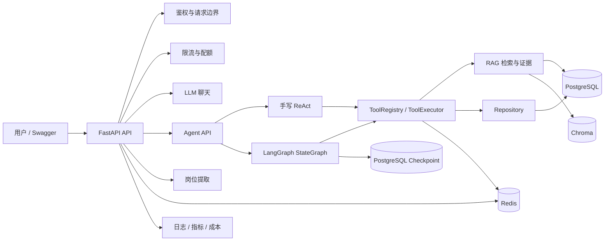
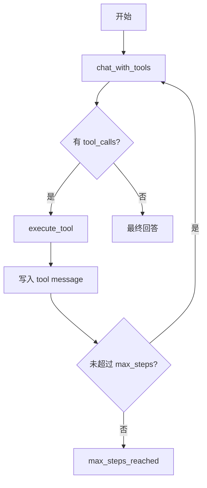
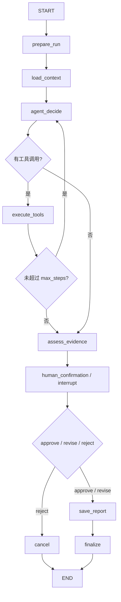
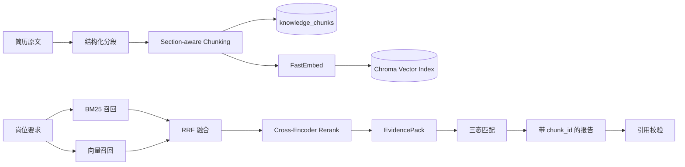
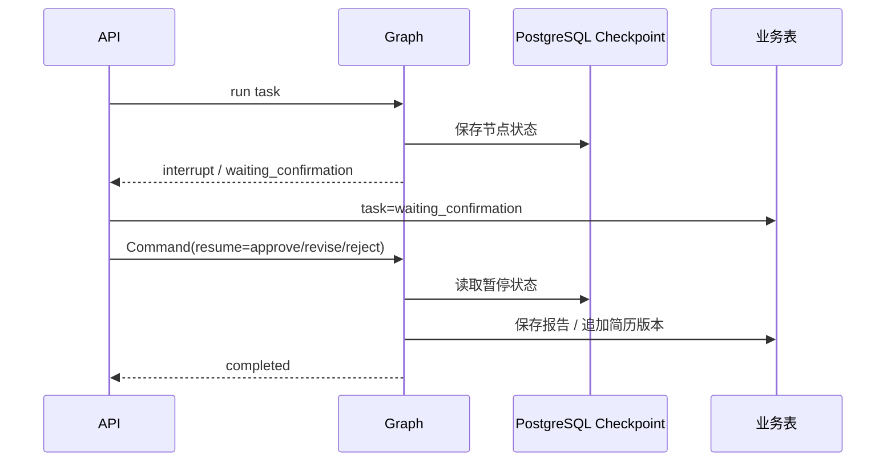

# JobFit Agent Architecture

## 1. 项目定位

JobFit Agent 是一个基于 RAG 和工具调用的可解释岗位匹配与差距分析 Agent。

核心链路：

```text
简历 + 岗位 JD
→ 岗位要求提取
→ 简历证据检索
→ 匹配状态评估
→ 报告与引用校验
→ 人工确认
→ 报告保存
→ 简历修改版本
```

---

## 2. 系统上下文



---

## 3. 分层职责

```text
API 层
  FastAPI、鉴权、请求校验、响应封装、SSE、限流

Agent 编排层
  手写 ReAct、LangGraph StateGraph、Checkpoint、Human-in-the-loop

Tool 层
  工具白名单、参数校验、ToolContext、超时、审计

RAG 层
  Chunking、FastEmbed、Chroma、BM25、RRF、Rerank、EvidencePack

Persistence 层
  PostgreSQL 业务事实、报告版本、任务状态、工具审计、Checkpoint

Infrastructure 层
  Redis 缓存和锁、日志、指标、成本、部署配置

Security 层
  Prompt Injection、输入长度、工具白名单、用户隔离、日志脱敏、限流
```

---

## 4. 双 Agent 引擎

### 4.1 手写 ReAct



保留目的：

```text
理解底层循环
作为行为基线
排查工具调用问题
对比框架实现
```

### 4.2 LangGraph



Graph 新增：

```text
PostgreSQL Checkpoint
人工确认中断恢复
节点级重试
节点级安全 SSE 事件
修改确认追加简历版本
```

---

## 5. RAG 数据流



职责边界：

```text
PostgreSQL 保存 Chunk 事实
Chroma 保存可重建向量索引
EvidencePack 保存本轮 Top-N 证据
报告只能引用 EvidencePack 中的 chunk_id
```

---

## 6. Checkpoint 与人工确认



线程标识：

```text
thread_id = jobfit-task-{task_id}-attempt-{attempt}
```

---

## 7. 安全边界

```text
用户身份由认证依赖和 Repository 校验
模型不能提交 user_id、task_id、报告版本或终态
工具只能从 ToolRegistry 白名单调用
JD、简历、会话历史和工具结果都视为不可信数据
高风险 Prompt Injection 直接拒绝
高风险操作必须经过人工确认
日志和 SSE 不记录隐藏思维链和敏感正文
Redis 做限流、缓存和运行锁
```

---

## 8. 可观测性与成本

```text
request_id 贯穿请求和日志
task_id 贯穿 Agent 执行
记录 model_ms、tool_ms、node_ms、total_ms
记录 Token Usage、模型调用次数和估算成本
metrics_json 保存任务运行指标
```

---

## 9. 部署形态

```text
开发：Windows 本地 FastAPI + 本地 PostgreSQL/Redis
生产资产：Dockerfile + docker-compose.prod.yml
运行时：Linux + Docker Engine
就绪检查：PostgreSQL、Checkpoint 表、Redis
```

当前状态：

```text
本机部署资产验证完成
私有 staging 和公网部署待 Linux 云服务器
```

---

## 10. 当前限制

```text
评估集仍较小，需要扩展独立 holdout
固定窗口限流可升级为滑动窗口或令牌桶
同进程长任务可进一步迁移到消息队列和 Worker
Checkpoint 表由 LangGraph setup 脚本维护
生产认证、审计和告警仍需继续完善
```
