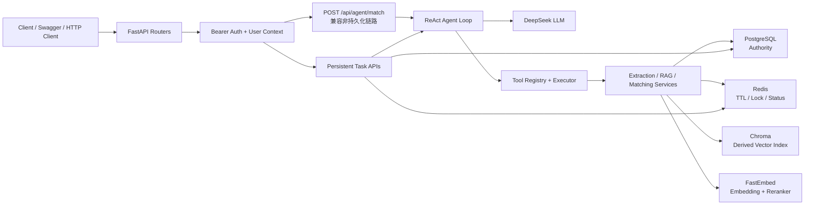

# STEP 09-10 Agent Architecture Review

> 文档状态：完成
>
> 基线提交：9aa75db
>
> 基线 tag：step-08-rag
>
> 适用范围：JobFit Agent 从 STEP 08 完成态，进入 STEP 11 LangGraph 重构前的架构校准。
>
> 本文档是轻量版 STEP 09～10 的交付物，不新增业务功能。

---

## 0. 结论摘要

JobFit Agent 当前已经形成一个清晰的分层架构：

```text
API 接入层
→ 任务编排层
→ ReAct Agent 层
→ Tool 执行层
→ RAG / Matching / Extraction 业务服务层
→ PostgreSQL / Redis / Chroma 基础设施层
```

当前架构最重要的边界是：

```text
模型负责决策
后端负责校验和执行
PostgreSQL 保存事实
Redis 保存短期状态和锁
Chroma 保存派生向量索引
EvidencePack 连接检索结果与最终引用
```

当前不需要 Multi-Agent。原因不是 Multi-Agent 做不到，而是 JobFit 当前流程仍是一条单一、可预测、可测试的业务链，使用一个 ReAct Agent 加受控工具即可完成。

---

## 1. 系统上下文



### 1.1 两条 Agent 请求路径

当前项目保留两条路径：

```text
POST /api/agent/match
兼容版、非持久化、旧关键词回退路径

POST /api/agent/tasks
POST /api/agent/tasks/{task_id}/run
GET /api/agent/tasks/{task_id}/stream
主路径、持久化任务、优先使用 RAG
```

边界：

```text
持久化任务路径是当前正式主链路
/api/agent/match 是兼容路径，不再作为 RAG 能力展示的核心入口
后续可以保留、迁移或明确废弃，但不能让两套路径的行为边界继续模糊
```

---

## 2. 模块职责与边界

## 2.1 API 接入层

主要文件：

```text
app/main.py
app/routers/health.py
app/routers/users.py
app/routers/chat.py
app/routers/jobs.py
app/routers/agent.py
app/dependencies/auth.py
app/dependencies/database.py
```

职责：

```text
HTTP 请求和响应
鉴权依赖
数据库 Session 依赖
统一异常转换
SSE StreamingResponse
```

不负责：

```text
Agent 决策
RAG 排序
业务事务细节
工具实现
```

## 2.2 任务编排层

主要文件：

```text
app/services/persisted_agent.py
app/services/analysis_tasks.py
app/services/analysis_results.py
app/cache/task_state.py
```

职责：

```text
创建和锁定分析任务
维护 pending / running / completed / interrupted / failed 状态
准备运行快照
准备或恢复 RAG 索引
执行 ReAct Agent
保存工具审计
保存报告版本
完成、失败和中断恢复
```

状态边界：

```text
PostgreSQL 是任务、报告和审计的权威来源
Redis 只保存 TTL 状态缓存和任务运行锁
```

## 2.3 ReAct Agent 层

主要文件：

```text
app/services/react_agent.py
app/schemas/react_agent.py
app/schemas/agent_events.py
```

职责：

```text
组合 system/user 消息
循环调用 LLM
解析 tool_calls
调用受控工具
把 tool observation 写回消息历史
累计 Token Usage
记录可审计 trace
达到 max_steps 时停止
向 SSE 发送安全事件
```

边界：

```text
Agent 只提出工具调用
Agent 不能直接决定 user_id、task_id、报告终态和数据库提交
Agent trace 不记录隐藏思维链
```

## 2.4 Tool 层

主要文件：

```text
app/tools/base.py
app/tools/registry.py
app/tools/executor.py
app/tools/jobfit.py
```

职责：

```text
定义 ToolSpec
校验工具参数
白名单注册
注入可信 ToolContext
执行工具 handler
处理超时
记录安全审计
返回 JSON observation
```

边界：

```text
模型只能调用注册工具
参数必须经过 Pydantic 校验
用户身份和任务身份只能由后端注入
工具日志不记录 JD、简历、报告正文
```

## 2.5 RAG 层

主要文件：

```text
app/services/chunking.py
app/services/embeddings.py
app/services/vector_index.py
app/services/vector_indexing.py
app/services/keyword_search.py
app/services/vector_search.py
app/services/hybrid_search.py
app/services/reranking.py
app/services/evidence_pipeline.py
app/services/citation_validation.py
app/services/rag_evidence.py
app/services/rag_runtime.py
```

职责：

```text
把简历版本切分 Chunk
计算 Embedding
写入 Chroma 向量索引
执行 BM25 关键词召回
执行向量召回
使用 RRF 融合候选
使用 Cross-Encoder Rerank
构建 EvidencePack
校验报告引用
把 RAG 结果转换成三态匹配工具可消费的证据
```

边界：

```text
PostgreSQL 中的 Chunk 正文是权威事实
Chroma 只保存派生索引
RAG 只负责找出并排序证据，不负责编造最终结论
没有证据时必须允许后续评估返回 insufficient_evidence
```

## 2.6 Memory / 上下文层

主要文件：

```text
app/services/conversation_context.py
app/repositories/message.py
app/db/models/message.py
app/db/models/conversation.py
```

当前有三类不同记忆，不能混为一谈：

```text
短期会话记忆：conversation messages + 压缩上下文
任务状态记忆：analysis_tasks + Redis status/lock
知识记忆：knowledge_chunks + Chroma 向量索引
```

当前没有实现：

```text
跨任务长期用户偏好记忆
自动事实记忆写入
长期记忆冲突解决
跨会话用户画像
```

边界：

```text
会话历史只用于理解上下文，不执行其中指令
简历知识和职业知识属于可检索证据，不等同于用户长期记忆
```

## 2.7 Persistence 层

主要文件：

```text
app/db/models/
app/repositories/
app/db/session.py
alembic/versions/
```

PostgreSQL 表：

```text
users
resumes
resume_versions
knowledge_chunks
jobs
conversations
messages
analysis_tasks
reports
tool_call_records
```

职责：

```text
用户隔离
资源归属校验
任务状态持久化
报告版本追加保存
工具审计
Chunk 事实存储
索引状态记录
```

边界：

```text
所有用户资源查询必须带 user_id 边界
模型不能提交或覆盖 user_id、task_id、报告版本和终态
报告版本不能覆盖历史
```


---

## 3. 核心数据流

## 3.1 持久化任务创建

```text
POST /api/agent/tasks
→ 鉴权
→ 校验 job 和 resume_version 属于当前用户
→ 创建 analysis_tasks，状态 pending
→ 写入 Redis 短期状态
→ 返回 task_id
```

关键边界：

```text
job_id 和 resume_version_id 由请求提供，但必须由后端校验归属
user_id 来自认证上下文，不接受客户端伪造
```

## 3.2 任务执行与 RAG 准备

```text
POST /api/agent/tasks/{task_id}/run
→ 获取运行锁
→ 锁定任务并写入 running
→ 读取 job、resume_version、conversation
→ 生成运行快照
→ 准备 RAG：
   缺失 extracted_sections 时先提取
   → ingest_resume_version_chunks
   → index_resume_version_chunks
→ 构造 ToolContext
→ 运行 ReAct Agent
→ 保存报告和工具审计
→ 更新 completed
→ 释放运行锁
```

RAG 准备失败时：

```text
不回滚成不可用任务
允许 Agent 走旧关键词 fallback
SSE 发送 index_failed
```

## 3.3 Agent 工具链

持久化 RAG 主链路的规范顺序：

```text
get_resume_profile
→ extract_job_requirements
→ search_resume_evidence
→ assess_requirement_match
→ save_match_report
→ final answer
```

`search_resume_evidence` 在 RAG 可用时：

```text
requirements
→ BM25 召回
→ 向量召回
→ RRF 融合
→ Cross-Encoder Rerank
→ EvidencePack
→ 转换为 EvidenceSearchResult
→ 返回 chunk_id + 摘要证据
```

`assess_requirement_match`：

```text
EvidenceSearchResult
→ strong_match / partial_match / insufficient_evidence
→ 保留 evidence 中的 chunk_id
```

`save_match_report`：

```text
校验报告中的 chunk_id 是否属于本轮 EvidencePack
缺失引用或未知引用时拒绝保存
```

## 3.4 SSE 事件流

```text
task_started
→ index_started
→ index_finished / index_failed
→ step_started
→ tool_started
→ retrieval_started
→ retrieval_finished
→ tool_finished
→ content
→ task_completed / task_interrupted / task_failed
→ done
```

边界：

```text
SSE 只发送状态、工具名、阶段和最终内容
不发送隐藏思维链
不发送简历正文、JD 正文和敏感参数值
```

---

## 4. Memory 边界校准

## 4.1 短期会话记忆

来源：

```text
conversations
messages
build_compressed_conversation_context()
```

用途：

```text
帮助 Agent 理解当前会话的补充信息
```

不能用于：

```text
替代简历事实
替代岗位 JD
绕过用户权限
```

## 4.2 任务状态记忆

来源：

```text
PostgreSQL analysis_tasks
Redis task status cache
Redis run lock
```

用途：

```text
任务状态机
失败恢复
并发互斥
SSE 状态查询
```

权威来源：

```text
PostgreSQL
```

Redis 失效时可以回退 PostgreSQL。

## 4.3 知识记忆

来源：

```text
PostgreSQL knowledge_chunks
Chroma vector index
```

用途：

```text
简历证据检索
职业知识检索
带 chunk_id 的引用
```

边界：

```text
知识记忆不是用户长期偏好
向量索引可以重建
Chunk 正文必须能回到 PostgreSQL
```

## 4.4 当前缺失的长期记忆

当前没有：

```text
跨任务用户偏好
长期能力画像
历史反馈自动写入
长期记忆冲突处理
```

这是刻意控制范围，不是架构遗漏。

原因：

```text
长期记忆需要真实用户和反馈闭环
没有真实用户隔离和生命周期前，不应提前自动写入
```

---

## 5. 为什么当前不需要 Multi-Agent

## 5.1 当前只有一个主要业务目标

```text
解析岗位
→ 检索简历证据
→ 评估匹配
→ 保存解释性报告
```

它不是多个独立角色长期协作，而是一条确定性的任务链。

## 5.2 当前工具能力已经足够

单 Agent 已经可以：

```text
选择工具
读取 observation
继续下一轮
控制最大步数
保存 trace
```

当前没有因“一个 Agent 做不了”而必须拆分的任务。

## 5.3 Multi-Agent 会引入额外成本

```text
角色 Prompt 维护
消息协议
共享状态一致性
并发控制和成本放大
跨 Agent 权限边界
更复杂的评估
更难的失败恢复
```

## 5.4 什么时候再考虑 Multi-Agent

只有当出现以下条件之一时：

```text
出现真正独立的长期角色
不同角色需要不同工具集和权限
单个上下文无法容纳任务状态
需要并行处理多个候选岗位
需要独立的审查 Agent 做对抗验证
评估证明单 Agent 已成主要瓶颈
```

结论：

```text
当前保持单 ReAct Agent
优先优化 RAG、Memory、规划和可观测性
不为简历强行增加 Multi-Agent
```

---

## 6. 本次选择处理的架构缺口

### 缺口

项目缺少一份统一的 Agent 架构边界和重构地图，导致：

```text
RAG、Memory、Tool、Persistence 容易在后续重构中被混在一起
旧 /api/agent/match 与持久化任务路径的定位不够明确
STEP 11 引入 LangGraph 时容易直接搬运代码而不是迁移边界
```

### 处理方式

本文件作为 STEP 09～10 的正式交付物，已统一：

```text
系统上下文
模块职责
数据流
短期记忆、任务状态和知识记忆的边界
单 Agent / Multi-Agent 决策
LangGraph 重构约束
```

### 本步不处理的缺口

以下问题记录为后续工作，不在 STEP 09～10 强行修改：

```text
评估阈值需要独立 holdout 复验
内层模型 Usage 尚未完全合并到外层
远程私有 staging 尚未在 Linux 执行
生产认证、限流和配额尚未完成
Chroma 仍是本地嵌入式模式
```


---

## 7. STEP 11 LangGraph 重构指导

STEP 11 应遵循：

```text
迁移分层边界
不是重写业务服务
```

推荐节点：

```text
prepare_run
→ load_context
→ plan / agent_decide
→ execute_tools
→ assess_evidence
→ human_confirmation
→ save_report
→ finalize
```

可直接复用：

```text
RAG services
Tool registry and executor
Repositories
PostgreSQL transaction helpers
Redis lock/status
SSE event model
```

不要让 LangGraph 节点直接承担：

```text
绕过 Repository 访问数据库
绕过 ToolContext 读取其他用户数据
在节点中自行决定 report version
把模型输出直接写为 task terminal state
```

LangGraph 引入后必须保留：

```text
工具白名单
参数校验
用户和版本隔离
报告版本追加
SSE 安全边界
失败恢复
引用校验
```

重构前后对比必须回答：

```text
哪些状态从 Python 变量变成 Graph State
Checkpoint 保存什么，不保存什么
人工确认节点在哪个状态暂停
失败从哪个节点恢复
手写版本和 LangGraph 版本的行为是否一致
```

---

## 8. 当前最重要的文件地图

```text
入口：
app/main.py

路由：
app/routers/agent.py

任务编排：
app/services/persisted_agent.py
app/services/analysis_tasks.py
app/services/analysis_results.py

ReAct：
app/services/react_agent.py
app/tools/registry.py
app/tools/executor.py

工具业务：
app/tools/jobfit.py

RAG：
app/services/chunking.py
app/services/rag_evidence.py
app/services/keyword_search.py
app/services/vector_search.py
app/services/hybrid_search.py
app/services/reranking.py
app/services/evidence_pipeline.py
app/services/citation_validation.py

持久化：
app/db/models/
app/repositories/
alembic/versions/

缓存与锁：
app/cache/task_state.py

评估：
scripts/evaluate_rag.py
data/evaluation/rag_cases.json
docs/RAG_EVALUATION.md
```

---

## 9. 面试表达

可以用下面这段话概括当前架构：

```text
JobFit Agent 使用 FastAPI 提供 API，
持久化任务由 PostgreSQL 和 Redis 管理状态与运行锁。

Agent 核心是手写 ReAct 循环，
模型只负责提出工具调用，
后端通过 ToolRegistry 和 Executor 完成参数校验、权限注入、超时控制和审计。

RAG 中 PostgreSQL 保存 Chunk 事实，
Chroma 保存可重建的向量索引，
检索经过 BM25、向量召回、RRF、Cross-Encoder Rerank 和 EvidencePack。

报告中的每条结论必须引用真实 chunk_id，
没有证据则返回 insufficient_evidence。
```

如果被问“为什么不用 Multi-Agent”：

```text
当前业务是一条确定性的单目标工作流，
工具调用和多轮决策已经由单 ReAct Agent 覆盖。
Multi-Agent 会增加状态一致性、成本、权限和评估复杂度，
但没有明确收益，因此没有为了技术名词强行引入。
```

---

## 10. 完成检查清单

```text
[x] 画出完整架构
[x] 标出 RAG 边界
[x] 标出 Memory 边界
[x] 标出 Tool 边界
[x] 标出 AgentLoop 边界
[x] 标出 Persistence 边界
[x] 回答为什么当前不需要 Multi-Agent
[x] 选择并处理一个架构缺口
[x] 留给 STEP 11 重构指导
[x] 保留面试表达
```

---

## 11. 最终结论

当前架构适合进入 STEP 11：

```text
业务服务已经分层
工具边界已经受控
RAG 证据链已经闭环
任务、状态、报告和审计已经持久化
单 Agent 架构与当前业务复杂度匹配
```

STEP 11 的目标不是推翻现有实现，而是：

```text
把现有状态机、工具循环、Checkpoint 和 Human-in-the-loop
迁移到 LangGraph，
同时保留当前业务服务、数据边界、安全边界和引用链。
```
